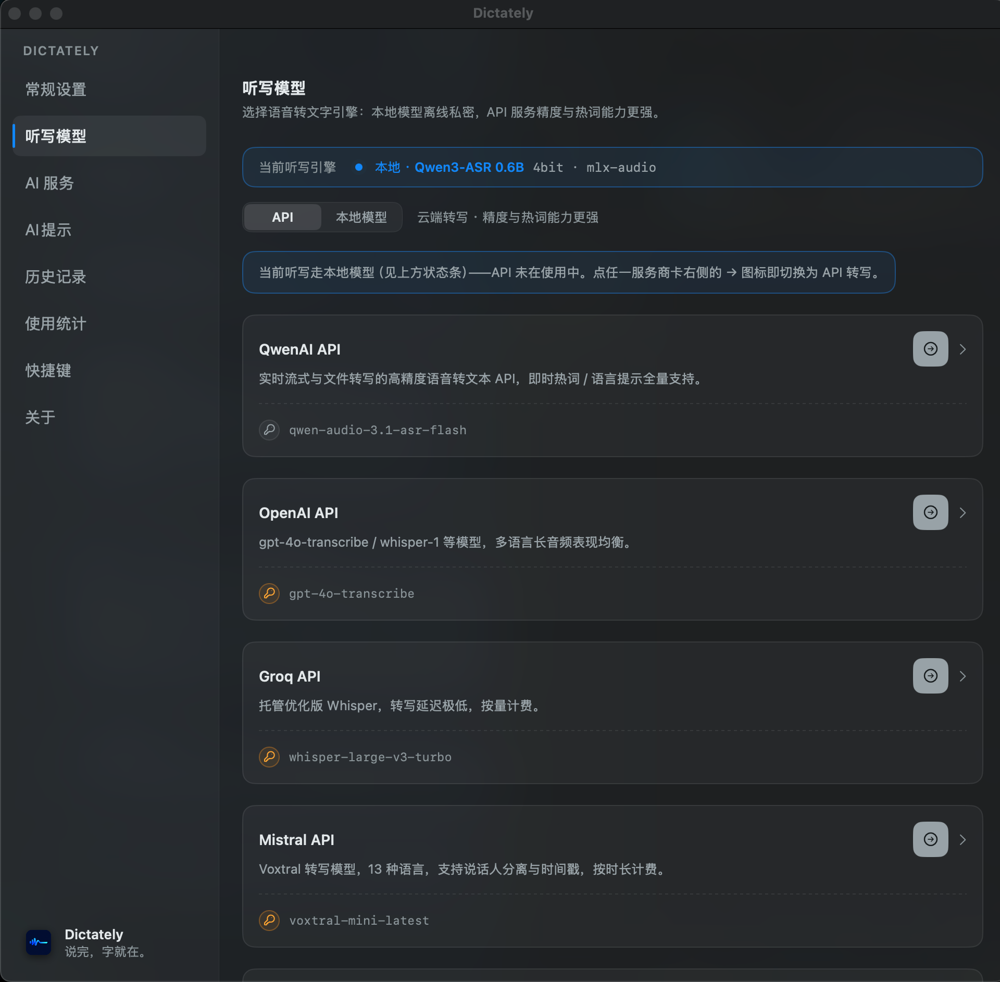
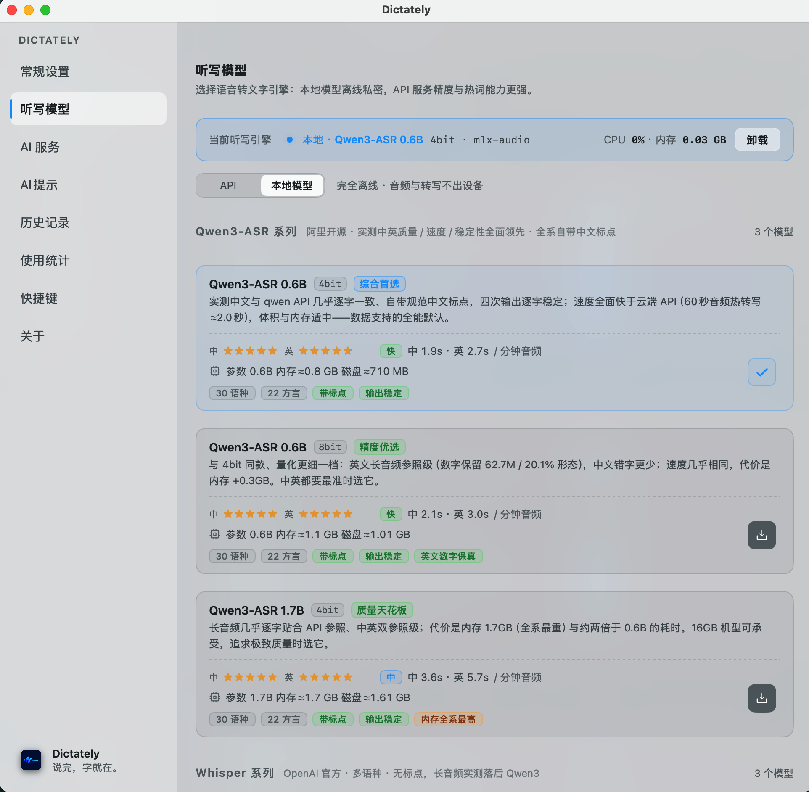
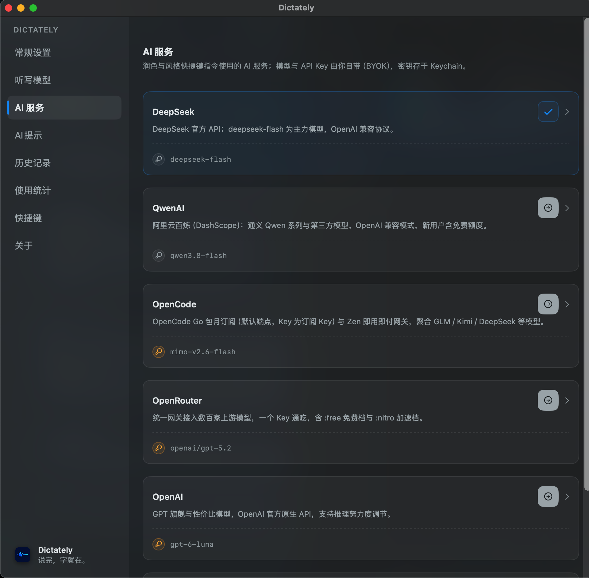
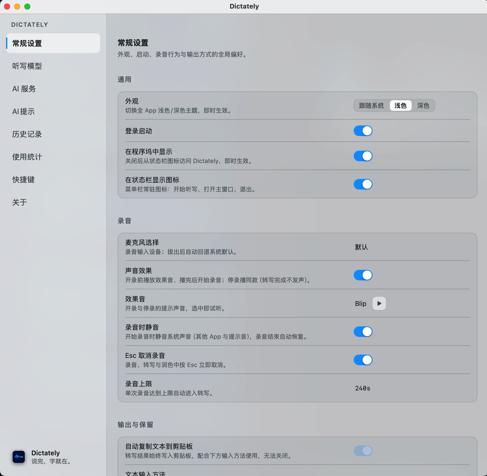
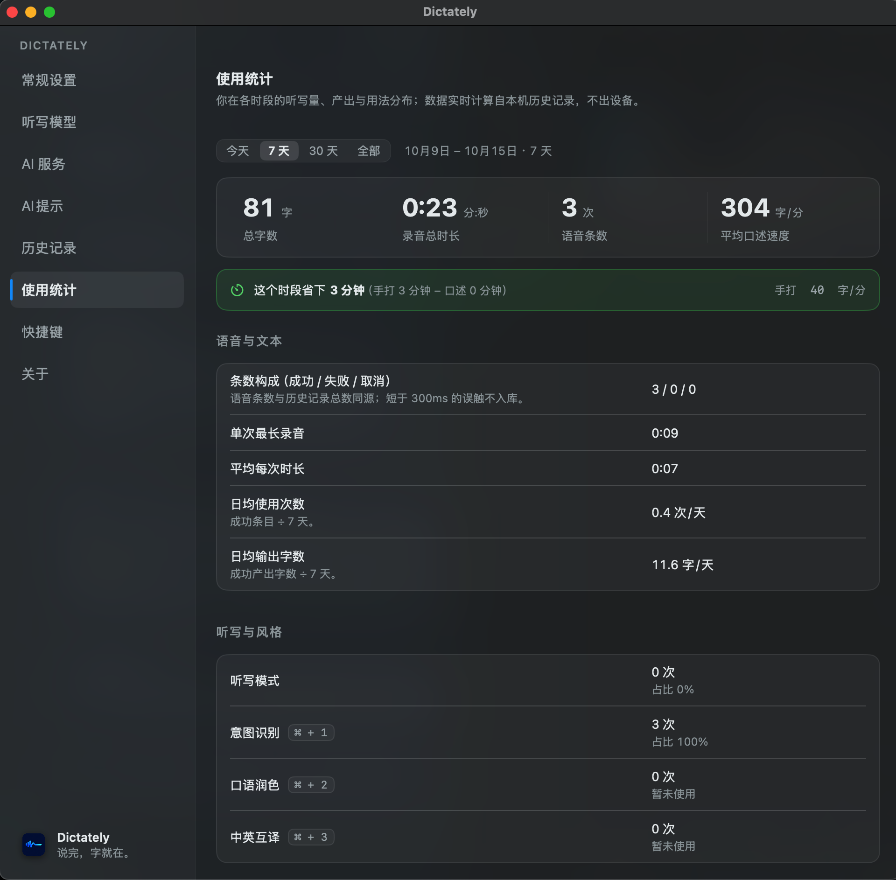
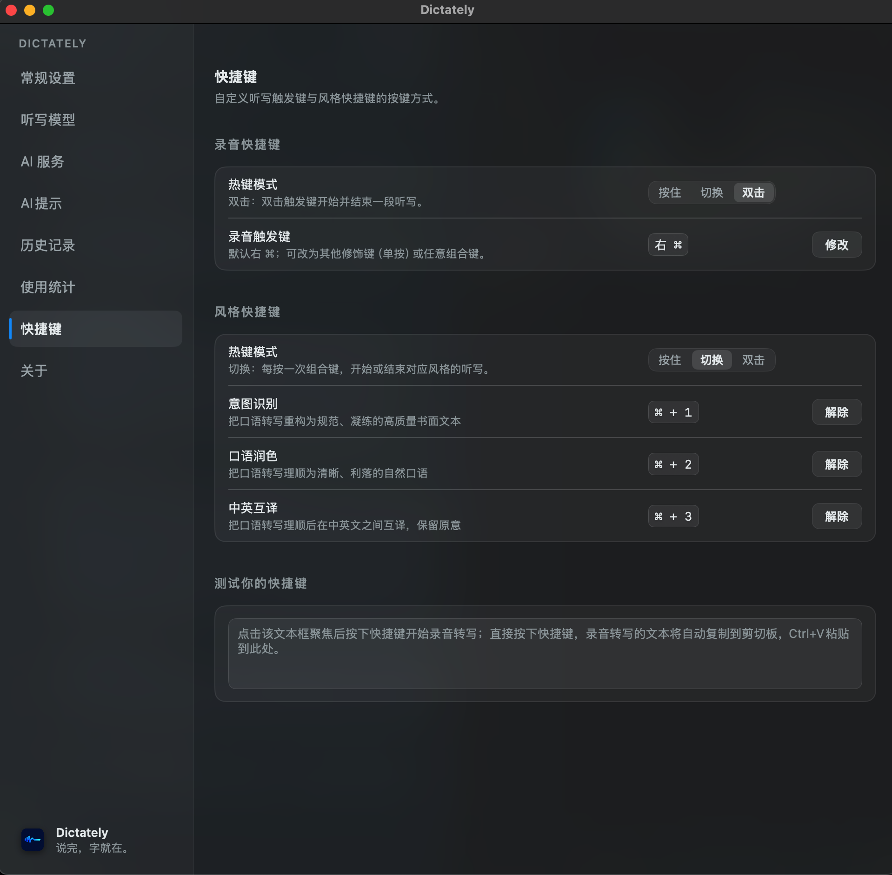

<div align="center">


# Dictately

**Speak. It's there.**

English · [简体中文](README.md)


A native macOS dictation tool: press the hotkey in any app, speak, and your words are transcribed in the cloud or locally on-device, optionally AI-polished, and pasted at your cursor within 1–3 seconds.

</div>

---

## Highlights

**Dictation**

- Start with a **double-tap of right ⌘** by default — the frontmost app keeps focus; trigger mode is switchable (double-tap / hold / toggle) and every hotkey is recordable and customizable; the trigger key can also be bound directly to an AI style (press = record → transcribe → polish with that style)
- The recording HUD floats at the bottom of the **screen your cursor is on**, with a live timer; `Esc` cancels at any point — recording, transcribing, or polishing
- Choose how text is delivered: standard paste (`⌘V`, with QWERTY / Colemak / Dvorak / Optimot layout support) or "simulate typing" character-by-character input for fields that refuse pastes; text is always copied to the clipboard as well
- Accidental-tap guard: recordings shorter than 300 ms are silently discarded instead of sending empty requests
- Recording cap adjustable from 90–300 seconds (default 240), auto-finishes on timeout

**Local offline transcription (optional)**

- 7 open-source models downloadable right inside the app (Qwen3-ASR / Whisper / BELLE Whisper Chinese, in three groups) — no API key needed, and **your audio never leaves this Mac**
- Dual download channels (ModelScope / HuggingFace) with resumable downloads and channel-switch retry; each model card shows measured quality / speed / memory figures to help you choose
- A resident engine transcribes on demand and unloads itself after 5 minutes idle; the status bar shows live CPU and memory usage

**AI styles**

- Three built-in styles to turn a raw transcript into finished text:
  - `⌘1` **Intent recognition** — restructures spoken transcription into clean, concise written text
  - `⌘2` **Casual polish** — keeps your natural spoken voice, trimming only filler and noise
  - `⌘3` **Chinese–English translation** — tidies the transcript, then translates between the two languages while preserving meaning
- Create your own styles: custom prompt templates (with a `{text}` placeholder), description, on/off toggle, and a dedicated hotkey each; style hotkeys also support **bare-modifier tap triggers** — tap and release ⌘ / ⌥ / ⌃ alone (either side) to fire, any keypress in between cancels it, so ⌘C / ⌘V are never affected

**File transcription & AI summaries**

- The File Transcription page turns audio files (mp3 / wav / m4a) into text in batches: multi-file queue, live per-segment progress, cancel and retry; works with a local model or any configured cloud provider (chosen per page, never touching global settings)
- **Long-audio auto-segmentation**: any duration is sliced at silence points (each segment ≤3 min), transcribed segment by segment, then stitched back — hour-long recordings come out intact; anomalous content (e.g. repeated segments) is detected and re-segmented automatically
- One-click **AI summaries** of transcripts: two built-in presets (meeting minutes / knowledge organizer) or a custom prompt (up to 8,000 characters); the summarizing service can follow your global default or be pinned to any configured provider and model; summaries render as formatted Markdown (headings / lists / tables / quotes) with copy and regenerate

**History & reliability**

- Transcripts, polished results, and audio are all stored locally (SQLite), with filtering, search, and multi-select batch delete
- Failure-friendly: network errors auto-retry once; dictation entries can be re-transcribed, and styled entries regenerated — finished transcripts re-run the polish, while unfinished ones automatically re-run transcription from the audio first
- **Usage stats**: entries, duration, character count, speaking speed, and daily averages across today / last 7 days / last 30 days / all time, a dictation-vs-style working-mode breakdown, and a time-saved estimate based on an adjustable typing speed

**Cloud providers, BYOK (bring your own key)**

- 5 transcription providers and 6 AI-service providers (see below); keys are stored per provider in the **macOS Keychain** — the local offline engine needs no key at all
- Reasoning effort is **off by default and actually enforced** — an explicit per-provider "off" parameter is sent rather than simply omitted
- Model parameters never send dirty values; leaving a field empty falls back to its default

**Details**

- Light / dark / auto appearance
- Optional: start/stop sound effects, system-wide mute while recording, API request logging, menu-bar icon, hiding the Dock icon, launch at login
- No accounts, no analytics, no telemetry

## Screenshots

| Dictation models · API (dark) | Dictation models · Local (light) | AI services (dark) |
| :---: | :---: | :---: |
|  |  |  |
| **General (light)** | **Usage stats (dark)** | **Hotkeys (dark)** |
|  |  |  |

## Getting started

Download the latest DMG from [Releases](../../releases), open it, and drag Dictately into **Applications**.

**First launch (important):** Dictately is signed with a self-signed certificate (not an Apple-recognized developer certificate) and is not notarized by Apple, so Gatekeeper will block the first launch. Use any of the following to allow it:

- **Right-click Dictately in Applications → Open → click “Open” again**;
- or System Settings → Privacy & Security → scroll down and click “Open Anyway”;
- or run in Terminal:

  ```bash
  xattr -d com.apple.quarantine /Applications/Dictately.app
  ```

A two-step onboarding walks you through granting microphone and accessibility access. The transcription API key is configured afterwards in the Dictation models settings page (which shows a hint chip and banner until one is set).

### In-app updates

**Check for Updates** on the About page completes the whole upgrade inside the app: check → download → install & relaunch (update packages are EdDSA-signature verified and installed by [Sparkle](https://sparkle-project.org); **versions updated this way never need another Gatekeeper approval** — only a manually downloaded DMG does). Updates are manual-only; the app never checks in the background. Early 0.1.x builds shipped no updater, so upgrading from them requires downloading the new DMG once by hand.

### Requirements

- macOS 14 (Sonoma) or later
- An Apple Silicon Mac (M1 or later; current builds are arm64-only, and local offline transcription relies on MLX, Apple Silicon-only as well)
- Cloud transcription needs an API key for at least one provider (some offer free tiers); alternatively, use local offline transcription with no key at all (the first use downloads ~500 MB of inference dependencies plus your chosen models)

### Permissions

| Permission | Purpose |
| --- | --- |
| Microphone | Recording speech; audio is sent only to the transcription service you configure |
| Accessibility | Global hotkey listening; pasting text into the frontmost app (simulated ⌘V) |

## Transcription providers (ASR)

Five cloud providers plus the local offline engine (see Local offline transcription above):

| Provider | Default model | Notes |
| :--- | :--- | :--- |
| QwenAI API | `qwen-audio-3.1-asr-flash` | Supports instant hot words (≤50), language hints, dialect retention |
| OpenAI | `gpt-4o-transcribe` | OpenAI-compatible endpoint |
| Groq | `whisper-large-v3-turbo` | OpenAI-compatible endpoint |
| Mistral | `voxtral-mini-latest` | OpenAI-compatible endpoint |
| Custom endpoint | — | Any OpenAI-compatible `/audio/transcriptions` (http allowed for local services) |

## AI-service providers (LLM)

**DeepSeek** (default) · **QwenAI** · **OpenCode** · **OpenRouter** · **OpenAI** · **Custom endpoint**

Each provider stores its own base URL / model / API key; pick a model from the preset dropdown or enter a custom model ID.

## Privacy & data

- **API keys live only in the macOS Keychain**, per provider, and are never uploaded anywhere
- **Local offline transcription runs entirely on this Mac** — neither audio nor text ever leaves the machine
- History and audio stay local: `~/Library/Application Support/Dictately/` (one click to open via General settings → Data folder)
- Audio retention: 30 days (default) / 90 days / forever
- Optional **API request log** (on by default, can be disabled in General settings): one line per request with endpoint, latency, and outcome metadata only; **API keys are always redacted**; auto-rotates at 5 MB
- Apart from the cloud ASR/LLM endpoints you configure, model-download channels (ModelScope / HuggingFace), and manual update checks (GitHub), the app makes no outbound network calls

## Building from source

Requires macOS 14+ and the Xcode Command Line Tools (`xcode-select --install`). **Full Xcode is not needed** — the project builds directly with SwiftPM; third-party runtime dependencies are [GRDB.swift](https://github.com/groue/GRDB.swift) (SQLite) and [Sparkle 2](https://github.com/sparkle-project/Sparkle) (in-app updates).

```bash
git clone https://github.com/Aprilpl/Dictately.git
cd Dictately
./scripts/build.sh          # swift build → assembles build/Dictately.app → signs it
open build/Dictately.app    # run it
```

> Note: for maintenance reasons the public repository does not ship the unit-test bundle; `swift build` and `./scripts/build.sh` are unaffected.

## Known limitations

- Local offline transcription needs a first-use download of inference dependencies (~500 MB) plus your chosen models (42 MB–1 GB each); per-model capability differences (e.g. the Whisper models produce no punctuation) are documented on each model card in settings.
- Intel Macs are not supported or tested (current builds are arm64 / Apple Silicon only).
- The app is not notarized: installing or overwriting with a manually downloaded DMG requires one more Gatekeeper approval (in-app updates are unaffected — see “In-app updates”).

## License

[MIT](LICENSE) © 2026 Aprilpl
